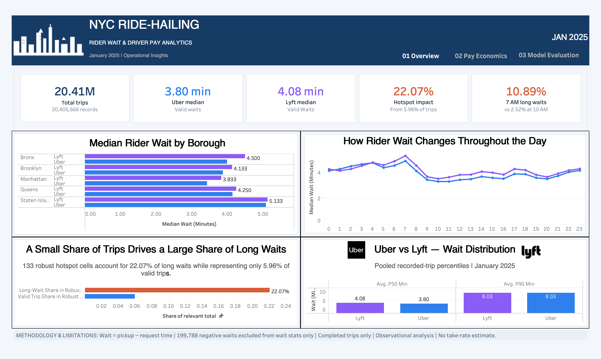

 <div align="center">


<br>

<p>
  
  
  
  
  
</p>

<h3>Understanding Rider Experience, Driver Economics & Operational Risk</h3>

<p>
  <i>
    An end-to-end mobility analytics case study using approximately 20.4 million NYC High Volume For-Hire Vehicle (HVFHV) trip records from January 2025.
    The project investigates rider pickup wait times, Uber vs Lyft differences, long-wait hotspots, driver pay economics, and predictive modeling of long-wait risk.
  </i>
</p>

</div>

---

# 📊 Executive Dashboards

### 01 — Executive Overview



### 02 — Driver Pay Economics


### 03 — Predictive Model Evaluation


---

# 🎯 Business Problem

Ride-hailing platforms operate in a marketplace where rider experience and driver economics are closely connected.

Long pickup waits can indicate operational friction for riders, while driver pay varies with trip distance, duration, geography, and platform.

Using NYC TLC High Volume For-Hire Vehicle trip records, this project investigates four core business questions:

1. **Rider Experience:** How do pickup wait times vary between Uber and Lyft, across boroughs, and throughout the day?
2. **Operational Hotspots:** Are long waits concentrated in particular geographic areas and time periods?
3. **Driver Economics:** How does recorded driver pay vary by company, trip distance, duration, and borough?
4. **Predictive Analytics:** Can historical trip and pickup-zone information identify trips with a higher risk of long waits?

The objective is to move beyond descriptive reporting and build a reproducible analytical workflow that translates large-scale trip data into operational insights.

---

# 🎯 TL;DR — Key Findings

- The analysis covers **20,405,666 trip records** from January 2025: 15,356,455 Uber trips and 5,049,211 Lyft trips.
- Uber recorded a lower median rider wait of **3.80 minutes**, compared with **4.08 minutes** for Lyft. Both companies had a P90 wait of approximately **8.03 minutes**.
- Long waits were geographically concentrated: **133 robust hotspot cells** accounted for **22.07% of long waits** while representing **5.96% of valid trips** in the hotspot analysis.
- The 7 AM period had a **10.89% long-wait rate**, compared with **2.52% at 10 AM**.
- Uber had a higher median recorded driver pay per trip (**$14.16 vs $13.32**), while Lyft had slightly higher median pay per mile (**$4.73 vs $4.60**).
- Median pay per mile declined with longer trip distances. For trips under one mile, Lyft recorded $7.77 and Uber $7.30; for trips of 20+ miles, the figures were approximately $2.65 and $2.63.
- The Random Forest model achieved the highest Average Precision (**0.1358**) and captured **35.74% of actual long waits within its highest-risk 10% of test predictions**.
- Logistic Regression achieved the highest ROC-AUC (**0.7015**). Random Forest had the lowest Brier score (**0.0416**).

> **Business takeaway:** Rider wait patterns and driver pay economics differ across companies, locations, and trip characteristics. The analysis identifies concentrated long-wait areas and demonstrates how predictive scores could help prioritize higher-risk trips for further operational investigation. These are observational findings, not proof of causal improvements.

---

# 📂 Dataset & Scope

## Dataset source

**New York City Taxi and Limousine Commission (NYC TLC) — [High Volume For-Hire Vehicle Trip Records](https://www.nyc.gov/site/tlc/about/tlc-trip-record-data.page).**

The project uses the **January 2025 HVFHV trip dataset**.

| Company | Trip records | Share |
|---|---:|---:|
| Uber | 15,356,455 | 75.25% |
| Lyft | 5,049,211 | 24.75% |
| **Total** | **20,405,666** | **100.00%** |

**Data grain:** One row represents one HVFHV trip record.

Supporting files include the TLC trip-record data dictionary and taxi-zone lookup table.

## Important fields used

| Field / Concept | Purpose |
|---|---|
| Request time | When the ride was requested |
| Pickup time | Recorded pickup time |
| Trip distance | Distance traveled |
| Trip duration | Duration of the trip |
| `driver_pay` | Recorded driver pay |
| Company | Uber or Lyft |
| Pickup location | Geographic pickup zone |
| Request attributes | Shared-ride and WAV request indicators |
| Request date and hour | Time-based analysis and modeling |

The analysis uses the recorded source fields and derived metrics. Field definitions are documented in the TLC data dictionary and the project's `GLOSSARY.md`.

---

# ⏱️ Rider Wait-Time Analysis

Rider wait time is calculated as:

```text
Rider Wait Time
= Pickup Time - Request Time
```

This measures the elapsed time between the recorded ride request and pickup.

## Uber vs Lyft

| Metric | Uber | Lyft |
|---|---:|---:|
| Median wait | **3.80 min** | **4.08 min** |
| P90 wait | 8.033 min | 8.033 min |

Uber had the lower median wait in the overall January dataset. However, overall company medians can be affected by differences in geography, trip mix, and operating periods.

The analysis therefore also examines wait-time distributions, geographic patterns, and comparisons across more comparable trip groups.

## Wait-time distribution

Rather than relying only on averages, the analysis uses multiple percentiles:

- **Median (P50):** Typical wait experienced by the middle trip.
- **P75:** Wait below which 75% of valid observations fall.
- **P90:** Wait below which 90% of valid observations fall.
- **P95 and P99:** Higher-end wait-time behavior.

This helps distinguish typical rider experience from the longer waits that may matter more for operational monitoring.

## Time-of-day patterns

The hourly analysis highlights differences in long-wait rates across the day.

| Period | Long-wait rate |
|---|---:|
| 7 AM | **10.89%** |
| 10 AM | **2.52%** |

The 7 AM rate was considerably higher than the 10 AM rate in this dataset. This is an observed time-of-day pattern and does not establish why the difference occurs.

---

# 📍 Geographic Hotspot Analysis

The project identifies geographic areas with concentrated long waits using pickup-zone-level analysis.

The hotspot workflow evaluates geographic and operational patterns rather than treating every zone with a high raw count as a meaningful hotspot.

## Key hotspot findings

| Metric | Result |
|---|---:|
| Robust hotspot cells | **133** |
| Valid waits represented | 1,203,811 |
| Long waits represented | 232,118 |
| Share of valid trips | 5.96% |
| Share of long waits | **22.07%** |

The selected hotspot cells represented a relatively small share of valid trips while accounting for a substantially larger share of long waits.

**Interpretation:** These locations are useful candidates for operational investigation and monitoring. The result does not prove that location alone causes longer waits.

---

# 💰 Driver Pay Economics

The driver-pay analysis examines how recorded pay differs between Uber and Lyft across trip characteristics.

The project uses the `driver_pay` field and derives normalized pay metrics to make trips of different lengths and durations more comparable.

## Key driver-pay metrics

| Metric | Uber | Lyft |
|---|---:|---:|
| Median recorded pay / trip | **$14.16** | $13.32 |
| Median pay / mile | $4.60 | **$4.73** |
| Median pay / minute | **$0.93** | $0.89 |

## Derived metrics

```text
Pay per Mile
= Driver Pay / Trip Distance
```

```text
Pay per Minute
= Driver Pay / Trip Duration (minutes)
```

These metrics are calculated only when the corresponding distance or duration is positive.

## Distance-based pay patterns

Median pay per mile decreases as trip distance increases.

| Trip distance | Uber median pay / mile | Lyft median pay / mile |
|---|---:|---:|
| Under 1 mile | $7.30 | **$7.77** |
| 20+ miles | $2.63 | $2.65 |

Short trips have higher median pay per mile than longer trips in this dataset.

This is a descriptive comparison, not a complete profitability calculation. It does not account for every driver operating cost, unpaid time, or other income sources.

## Important distinction

- `driver_pay` is recorded driver pay, not total driver earnings.
- Pay-per-mile and pay-per-minute calculations have different eligible populations.
- The available fields do not support a reliable calculation of the platform's take rate.

---

# 🤖 Predictive Modeling — Long-Wait Risk

The project includes a predictive modeling workflow to evaluate whether trip context can help identify trips with a higher likelihood of long waits.

The target is a binary long-wait indicator defined in the modeling workflow.

## Modeling dataset

A modeling sample of **201,602 observations** was used.

The chronological split prevents future test-period observations from entering model training.

| Dataset | Date range | Rows | Long waits | Rate |
|---|---|---:|---:|---:|
| Train | Jan 1–21 | 134,168 | 7,468 | 5.57% |
| Validation | Jan 22–24 | 20,991 | 1,041 | 4.96% |
| Test | Jan 25–31 | 46,443 | 2,107 | 4.54% |

## Features used

The modeling workflow uses operational and request-level features:

- Request date
- Request hour
- Day of week
- Pickup zone
- Company
- Shared-ride request
- Wheelchair-accessible vehicle (WAV) request

## Model comparison

| Model | Average Precision | ROC-AUC | Brier Score | Top 10% long-wait rate | Long-wait capture |
|---|---:|---:|---:|---:|---:|
| Zone-hour baseline | 0.1204 | 0.6643 | 0.0421 | 12.68% | 27.95% |
| Logistic Regression | 0.1282 | **0.7015** | 0.0419 | 15.63% | 34.46% |
| Random Forest | **0.1358** | 0.6905 | **0.0416** | **16.21%** | **35.74%** |

## Model interpretation

- **Random Forest:** Highest Average Precision and strongest top-10% long-wait capture.
- **Logistic Regression:** Highest ROC-AUC, indicating the strongest overall ranking discrimination by this metric.
- **Random Forest:** Lowest Brier score, although the difference between models is small.

### What does 35.74% capture mean?

The model ranks test trips by predicted long-wait risk.

The highest-risk 10% of predictions contained **35.74% of all actual long waits** in the held-out test set.

This is a prioritization result, not an accuracy score. It indicates that the model concentrates more long waits in a smaller group of predicted trips than a simple baseline.

**Conclusion:** Random Forest was strongest on Average Precision and top-10% capture, while Logistic Regression had the highest ROC-AUC. The results show useful predictive signal, but do not prove that deploying the model would reduce actual rider wait times.

---

# 🧭 Analytical Approach

The project combines SQL, Python, statistical summaries, exploratory analysis, and Tableau dashboards.

## 1. Data ingestion and quality checks

The January 2025 HVFHV dataset was loaded and inspected before analysis.

The workflow includes:

- Source-field and data-type validation.
- Timestamp and trip-duration checks.
- Negative and invalid wait-time checks.
- Distance and driver-pay eligibility checks.
- Company and pickup-zone validation.
- Documentation of assumptions and analytical decisions.

### Negative wait-time handling

The dataset contains **199,788 negative wait-time records**, approximately **0.979%** of all records.

These records are excluded from wait-time statistics because a negative request-to-pickup interval is not a valid wait duration.

They are excluded only from the relevant wait-time calculations, not automatically removed from every other analysis.

## 2. SQL analysis with DuckDB

DuckDB SQL is used to work with the large trip dataset and create reproducible analytical outputs.

The SQL workflow supports:

- Trip-level validation and preparation.
- Wait-time calculations and percentile summaries.
- Company and hourly comparisons.
- Geographic hotspot analysis.
- Driver-pay aggregation.
- Model-related data preparation.

SQL files are maintained in the `sql/` directory.

## 3. Python analysis

Python and Pandas are used for data processing, analysis, model preparation, and evaluation.

The notebooks document the analytical workflow and support reproducibility.

## 4. Statistical and comparative analysis

The analysis uses medians and percentiles to describe skewed wait and pay distributions.

Company comparisons are interpreted with attention to differences in trip mix and geography. Comparisons across more comparable groups help reduce the risk of drawing misleading conclusions from overall averages.

## 5. Predictive modeling

A chronological train-validation-test design was used to evaluate a baseline, Logistic Regression, and Random Forest.

The model comparison considers:

- Average Precision.
- ROC-AUC.
- Brier Score.
- Top-10% long-wait rate.
- Long-wait capture.

## 6. Tableau visualization

The final Tableau workbook presents the findings in three connected dashboards:

1. Executive Overview
2. Driver Pay Economics
3. Predictive Model Evaluation

The dashboard navigation allows stakeholders to move between rider experience, driver economics, and predictive performance.

---

# 📊 Tableau Dashboard Design

The workbook is organized into three decision-oriented dashboards.

| Dashboard | Main focus |
|---|---|
| **01 — Executive Overview** | Trip volume, company wait-time comparison, hourly patterns, borough analysis, and hotspot concentration |
| **02 — Driver Pay Economics** | Median recorded pay, pay per mile, pay per minute, distance patterns, duration patterns, and borough comparisons |
| **03 — Model Evaluation** | Held-out test performance, model comparison, Average Precision, ROC-AUC, Brier Score, and long-wait capture |

### Design system

The dashboards use a consistent visual language:

| Element | Color |
|---|---|
| Navy header | `#163B65` |
| Uber blue | `#2F80ED` |
| Lyft purple | `#8B5CF6` |
| Risk coral | `#D95D39` |
| Background | `#F3F6FA` |
| Supporting text | `#64748B` |

The workbook includes KPI cards, comparison charts, model evaluation views, and consistent navigation across all three dashboards.

**Tableau workbook:** [`dashboard/NYC_HVHFV_Analytics.twbx`](dashboard/NYC_HVHFV_Analytics.twbx)

The packaged `.twbx` workbook was reopened and checked independently to verify that the dashboards, visuals, and navigation were available without missing-file warnings.

---

# 🧠 What This Project Demonstrates

| Area | Skills demonstrated |
|---|---|
| **Python** | Pandas, data processing, analytical workflows, feature preparation |
| **SQL** | DuckDB, aggregations, analytical queries, data validation |
| **Data Analysis** | Distribution analysis, percentiles, company comparisons, operational KPIs |
| **Data Quality** | Timestamp validation, negative waits, metric eligibility, documented assumptions |
| **Geospatial Analysis** | Pickup-zone analysis, hotspot identification, geographic concentration |
| **Driver Economics** | Recorded pay analysis, normalized pay metrics, distance and duration comparisons |
| **Machine Learning** | Logistic Regression, Random Forest, chronological model evaluation |
| **Model Evaluation** | Average Precision, ROC-AUC, Brier Score, top-decile capture |
| **Tableau** | Multi-dashboard design, KPIs, comparative visualizations, navigation |
| **Business Thinking** | Rider experience, driver economics, operational prioritization, limitations-aware recommendations |

---

# 📂 Project Structure

```text
nyc-mobility-driver-economics/
│
├── README.md
├── GLOSSARY.md
├── DECISIONS.md
│
├── dashboard/
│   ├── NYC_HVHFV_Analytics.twbx
│   ├── assets/
│   │   ├── Overview.png
│   │   ├── Pay Economics.png
│   │   ├── Model Evaluation.png
│   │   ├── uber_logo.png
│   │   ├── lyft_logo.png
│   │   └── NYC skyline assets
│   │
│   └── data/
│       └── Dashboard and analytical CSV outputs
│
├── data/
│   ├── data_dictionary_trip_records_hvfhs.pdf
│   ├── taxi_zone_lookup.csv
│   └── fhvhv_tripdata_2025-01.parquet
│
├── notebooks/
│   ├── 01_stage1a_timestamps.ipynb
│   ├── ...
│   └── 14_stage4_predictive_modeling.ipynb
│
├── reports/
│   ├── NYC_HVHFV_Excel_Analysis_Workbook.xlsx
│   ├── NYC_HVHFV_Project_Master_Handoff.md
│   └── NYC_HVHFV_Project_Master_Handoff.docx
│
└── sql/
    └── SQL analysis and validation scripts
```

Large local Parquet datasets are excluded from version control. The raw January 2025 data is obtained from the NYC TLC source when reproducing the full workflow.

---

# 🔁 Reproducibility

## 1. Obtain the source dataset

Download the January 2025 High Volume For-Hire Vehicle trip records from the official [NYC TLC Trip Record Data page](https://www.nyc.gov/site/tlc/about/tlc-trip-record-data.page).

Place the downloaded file in the project's `data/` directory using the expected filename:

```text
data/fhvhv_tripdata_2025-01.parquet
```

Also retain the TLC trip-record data dictionary and taxi-zone lookup file.

The raw Parquet dataset is intentionally excluded from the public Git repository because of its large file size.

## 2. Explore the notebooks

Open the notebooks in:

```text
notebooks/
```

The notebooks document the stages of data processing, analysis, and predictive modeling.

Use a Python environment with the libraries required by the individual notebooks installed.

## 3. Run the SQL workflow

SQL source files are maintained in:

```text
sql/
```

The queries are written for DuckDB and support the project's data validation, wait-time analysis, hotspot analysis, driver-pay calculations, and model preparation.

## 4. Review the analytical outputs

Supporting CSV outputs used by the analysis and Tableau dashboards are maintained in:

```text
dashboard/data/
```

These files contain derived analytical results rather than the original raw trip-level dataset.

## 5. Open the Tableau workbook

Open:

```text
dashboard/NYC_HVHFV_Analytics.twbx
```

The packaged workbook contains the final three-dashboard experience and was independently reopened and checked.

---

# ⚠️ Limitations & Interpretation

- **Time scope:** The analysis covers January 2025 only. Findings should not automatically be generalized to other months, seasons, or years.
- **Observed trip records:** The dataset represents recorded trip activity. It does not capture all unmet demand, including requests that did not result in an observed trip.
- **Negative waits:** Negative request-to-pickup intervals were excluded from wait-time statistics, but were not automatically removed from unrelated analyses.
- **Company comparisons:** Uber and Lyft may serve different trip, geographic, and time-of-day mixes. Raw median differences should not be interpreted as pure platform-performance effects.
- **Hotspot interpretation:** Geographic concentration identifies areas worth investigating; it does not prove that a particular location causes longer waits.
- **Recorded driver pay:** `driver_pay` is not a complete measure of total driver earnings or take-home profit.
- **Pay eligibility:** Pay-per-mile and pay-per-minute metrics use different eligible populations because their denominators have different validity requirements.
- **Platform take rate:** The available fields do not provide the necessary fare and platform-revenue information to calculate take rate reliably.
- **Predictive modeling:** The model uses a held-out chronological test period from January 25–31, 2025. Results may change on future data or under different operating conditions.
- **Rare positive class:** Long waits form a relatively small share of the modeling sample. Average Precision and top-decile capture are therefore useful alongside ROC-AUC.
- **No causal claim:** Predictive performance does not prove that a model or operational intervention will reduce rider wait times.
- **Operational deployment:** Live deployment would require further validation, monitoring, and evaluation against real operational outcomes.

---

# 🔗 Source & Attribution

- **Dataset:** New York City Taxi and Limousine Commission (NYC TLC), [High Volume For-Hire Vehicle Trip Record Data](https://www.nyc.gov/site/tlc/about/tlc-trip-record-data.page).
- **Data period:** January 2025.
- **Supporting documentation:** NYC TLC HVFHV trip-record data dictionary and taxi-zone lookup.
- **Project work:** Data preparation, SQL queries, analytical workflows, Python notebooks, predictive modeling, KPI calculations, and Tableau dashboards were developed as part of this portfolio case study.

The original trip data remains subject to the source's terms. This repository provides analytical code, derived outputs, documentation, and attribution; it does not claim ownership of or relicense the original TLC dataset.

---

<div align="center">

**Built with Python • DuckDB SQL • Tableau • Machine Learning**

*Turning large-scale mobility data into measurable operational insights.*

</div>


# 👤 Author

<div align="left">


<strong>Syed Abdul Waheed</strong><br/>
<em>Data Analyst | Product Analytics | Data Science</em>

<br/><br/>

I enjoy turning raw data into clear business decisions — from SQL analysis and dashboards to experimentation and predictive modeling.

<br/><br/>

<a href="https://www.linkedin.com/in/syed-abdul-waheed/">
  
</a>
<a href="https://github.com/Syed-Waheed">
  
</a>

</div>

<br clear="left"/>

---

<div align="center">

### ⭐ If you found this project useful, consider starring the repository.

</div>


